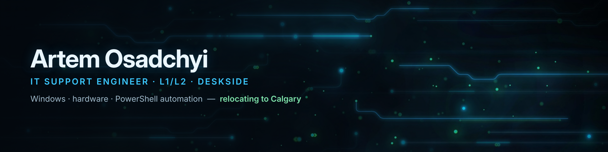

### Hi, I'm Artem

IT Support Engineer with 5+ years in L1/L2 support, deskside work and hardware repair. In a 14-person service desk team I closed about half of all tickets and wrote a bot that took over most of the repetitive ones. Here I keep the tools I build for that kind of work.

**Relocating to Calgary, AB** · Canadian open work permit · open to IT support, service desk and deskside roles.

---

#### What I build

| Project | What it does |
|---|---|
| [**Migrator**](https://github.com/Traible/Migrator) | PowerShell tool that backs up a Windows user profile into one archive and restores it on the same PC, another PC or a new account. Skips junk, respects OneDrive/iCloud, ships an offline restore kit. Up to ~5x faster than copying by hand. |
| [**Sanitar**](https://github.com/Traible/Sanitar-releases) | Finds and removes malware that has dug into Windows — hidden miners, RDP backdoors, antivirus blockers. One portable `.exe`. |

#### Toolbox

#### A few numbers

- Handled **~50%** of all tickets in a 13–14-person L1/L2 support team
- Built a bot that took over **~80%** of repetitive support tasks
- Built and ran a **200+ GPU (~70 kW)** compute facility — assembly, monitoring, break-fix, cooling
- Built a company's service department and ticketing workflow from scratch, then led its team

#### Find me

